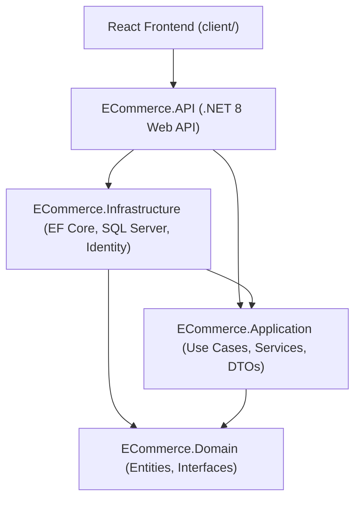

# 🛍️ Modern E-Commerce Platform (Full-Stack)

A production-ready, clean, full-stack E-Commerce platform built with **ASP.NET Core Web API (.NET 8)** using **Onion Architecture** and **React 19 + Vite** with **Tailwind CSS**.

---

## 🏛️ System Architecture

The backend strictly follows **Onion (Clean) Architecture** rules. Dependencies flow inward toward the Domain layer:



### Dependency Rules:
1. **Domain**: Independent core. Contains pure entities, enums, repository contracts (`IGenericRepository`, `IUnitOfWork`), and permission definitions. Zero dependencies on database or web frameworks.
2. **Application**: Contains business logic (`ProductService`, `CategoryService`, `CartService`, `OrderService`, `TrashService`), DTOs, FluentValidation rules, and mappings. References **Domain** only.
3. **Infrastructure**: Implements persistence (`AppDbContext`, `GenericRepository`, `UnitOfWork`), ASP.NET Core Identity (`AppUser`, `AppRole`), JWT tokens, and `StatisticsService`. References **Application** and **Domain**.
4. **API**: Presentation layer with controllers (`ProductsController`, `CategoriesController`, `CartController`, `OrdersController`, and `Admin` controllers), middleware, swagger, and rate limiting. References **Application** and **Infrastructure**.
5. **Client**: Modern React single-page application built with Vite, React Router, Tailwind CSS, TanStack React Query, Lucide icons, and Recharts.

---

## 🛡️ Security & Permissions Matrix

The platform implements strict **Permission-Based Authorization**. Permissions are claims embedded in JWT tokens and evaluated via dynamic policies (`[HasPermission]`).

| Permission Name | Module | Description | SuperAdmin | Admin | Moderator | Customer |
| :--- | :--- | :--- | :---: | :---: | :---: | :---: |
| `Product.View` | Product | View public catalog | ✅ | ✅ | ✅ | ✅ |
| `Product.Manage` | Product | Create, update, soft-delete products, upload images | ✅ | ✅ | ✅ | ❌ |
| `Category.Manage` | Category | Create, update, soft-delete departments & categories | ✅ | ✅ | ✅ | ❌ |
| `Order.Manage` | Order | View customer orders, transition order statuses | ✅ | ✅ | ❌ | ❌ |
| `User.Manage` | User | View users, assign roles, lock/unlock accounts | ✅ | ❌ | ❌ | ❌ |
| `Role.Manage` | Role | Create, edit, delete roles, manage permissions matrix | ✅ | ❌ | ❌ | ❌ |
| `Statistics.View` | Statistics | Access admin analytics dashboard, revenue timelines | ✅ | ✅ | ❌ | ❌ |
| `Trash.Manage` | Trash | View deleted items, restore records, hard delete | ✅ | ✅ | ❌ | ❌ |

> **Note**: Users with the `SuperAdmin` role automatically bypass all permission checks.

---

## 👤 Seeded Test Accounts

The system automatically initializes and seeds the database idempotently on application startup:

| Account Role | Email Address | Default Password | Access Level |
| :--- | :--- | :--- | :--- |
| **SuperAdmin** | `superadmin@shop.com` | `Admin123!` | Full system access & role governance |
| **Admin** | `admin@shop.com` | `Admin123!` | Catalog, Orders, Statistics & Trash |
| **Moderator** | `moderator@shop.com` | `Admin123!` | Products & Categories management |
| **Customer** | `customer@shop.com` | `Customer123!` | Storefront shopping, Cart & Orders |

---

## 🚀 Setup & Running Instructions

### Prerequisites
- [.NET 8 SDK](https://dotnet.microsoft.com/download/dotnet/8.0)
- [Node.js (v18+ recommended)](https://nodejs.org/)
- SQL Server (LocalDB or SQL Server Express)

### 1. Database & Backend API Setup

1. Open PowerShell and navigate to the project root:
   ```bash
   cd c:\Users\khumarao\Desktop\StoreProject
   ```

2. Build the solution and run tests:
   ```bash
   dotnet build
   dotnet test
   ```

3. Run the API project (database migrations and seeder will execute automatically on startup):
   ```bash
   cd src\ECommerce.API
   dotnet run
   ```
   The backend API will start at: `http://localhost:5078`
   Swagger UI: `http://localhost:5078/swagger`

---

### 2. Frontend Client Setup

1. Open a new terminal and navigate to the client directory:
   ```bash
   cd c:\Users\khumarao\Desktop\StoreProject\client
   ```

2. Install dependencies (if not already installed):
   ```bash
   npm install
   ```

3. Start the Vite development server:
   ```bash
   npm run dev
   ```
   The storefront will launch at: `http://localhost:5173`

---

## 🔍 Key Architectural Highlights

### 1. Soft Delete & Cascade Protection
- Both `Product` and `Category` implement `ISoftDeletable`.
- Global EF Core Query Filters (`HasQueryFilter(e => !e.IsDeleted)`) ensure soft-deleted records never leak to public queries, search, carts, order placement, or active statistics.
- Soft-deleting a `Category` automatically cascade-hides its active products.
- When restoring a product from the Trash bin, the system enforces that its parent category must be active first.
- Permanent physical purge (`HardDelete`) is blocked if a product is referenced in historical customer order line snapshots (`OrderItem`).

### 2. Concurrency-Safe JWT Refresh Flow
- Short-lived Access Tokens (60 min) with rolling Refresh Tokens (7 days).
- Client Axios interceptor catches `401 Unauthorized` responses and pauses subsequent requests using a queue while fetching a fresh access token, preventing multiple simultaneous refresh calls.

### 3. Rate Limiting & Protection
- Authentication endpoints (`/api/auth/*`) are protected by an ASP.NET Core rate limiter (15 requests/minute per client IP) to defend against brute-force attacks.
- Multi-factor file validation on image uploads (MIME type check, file signature validation, 5MB file cap).
